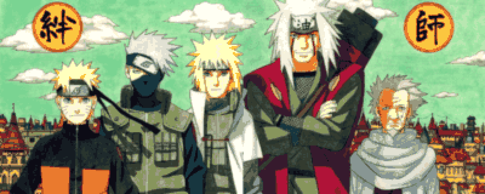

  

<h3 align="center">影分身是投机解码，螺旋丸是 KV Cache。</h3>

  Shadow clones are speculative decoding. The Rasengan is KV-cache compression.

  <code>LLM Inference</code>
  &nbsp;·&nbsp;
  <code>KV Cache</code>
  &nbsp;·&nbsp;
  <code>CUDA / Triton</code>
  &nbsp;·&nbsp;
  <code>Ascend NPU</code>

 

  木叶 · 还在往火影岩上爬

  fan art · pixelated for fun

